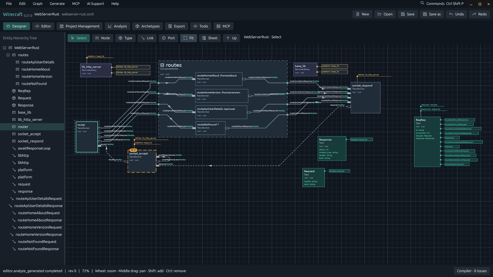
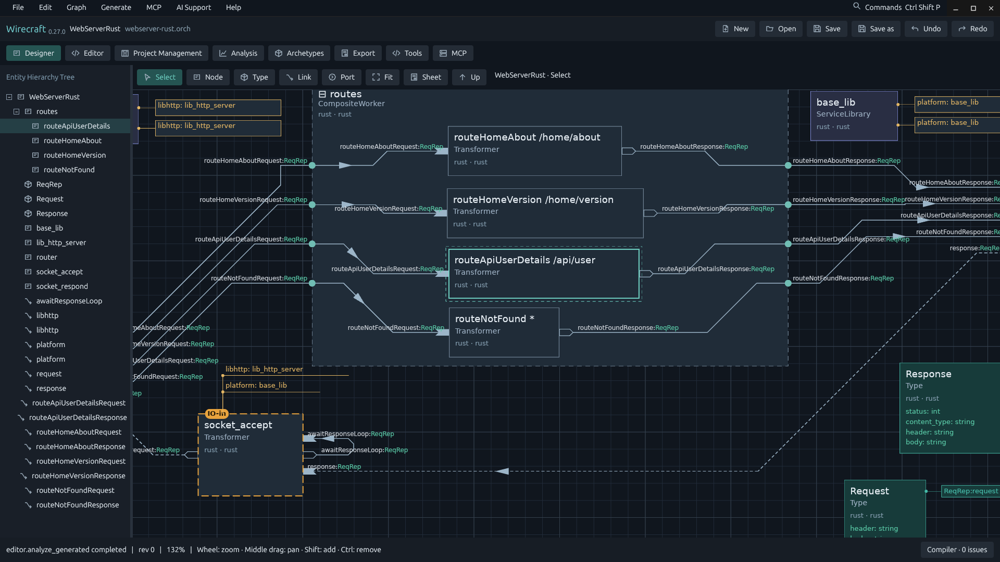
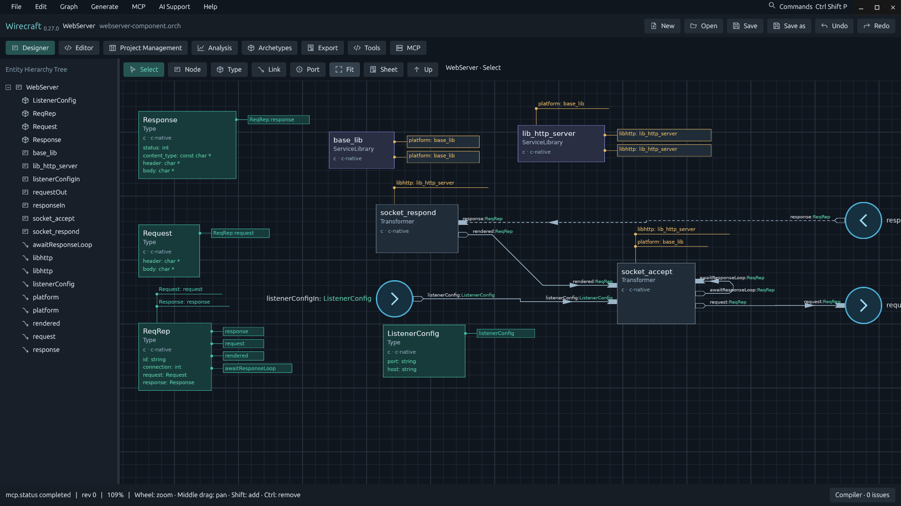
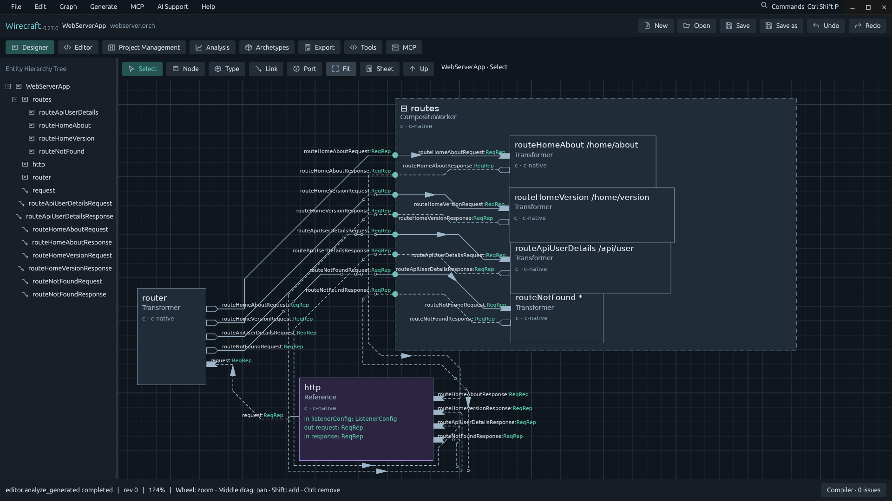
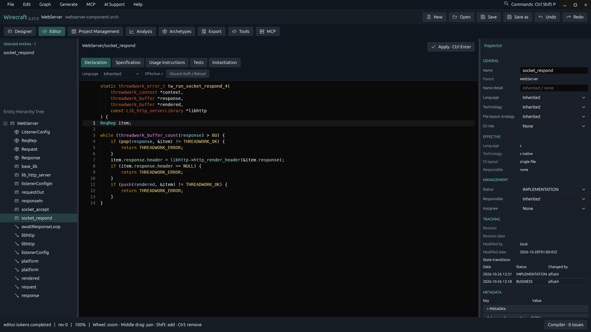
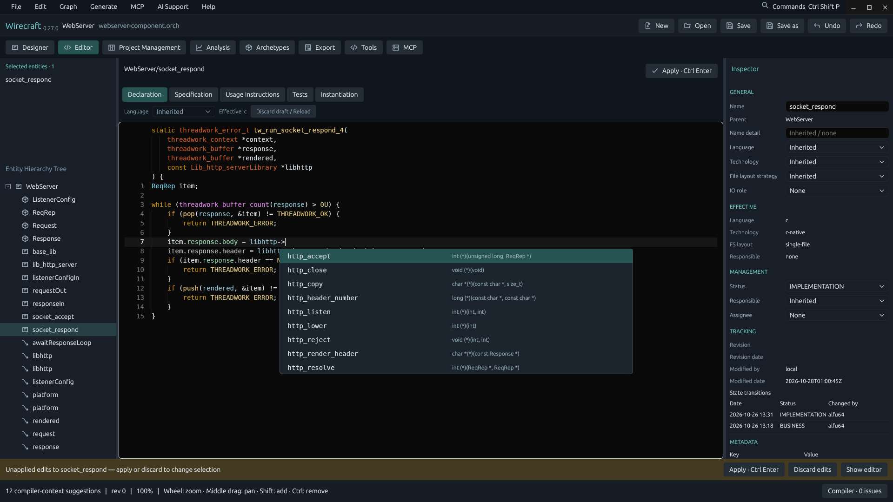
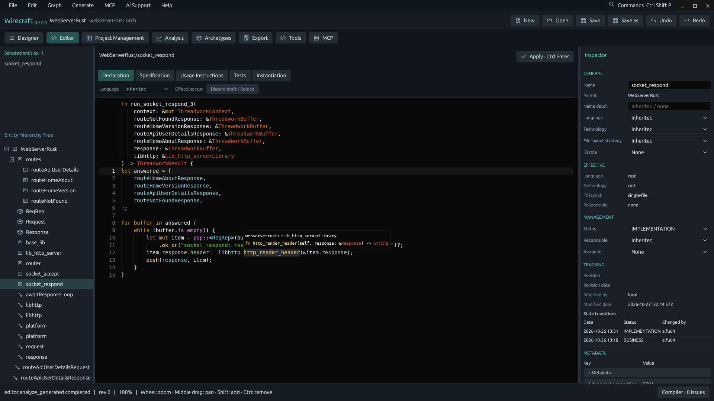
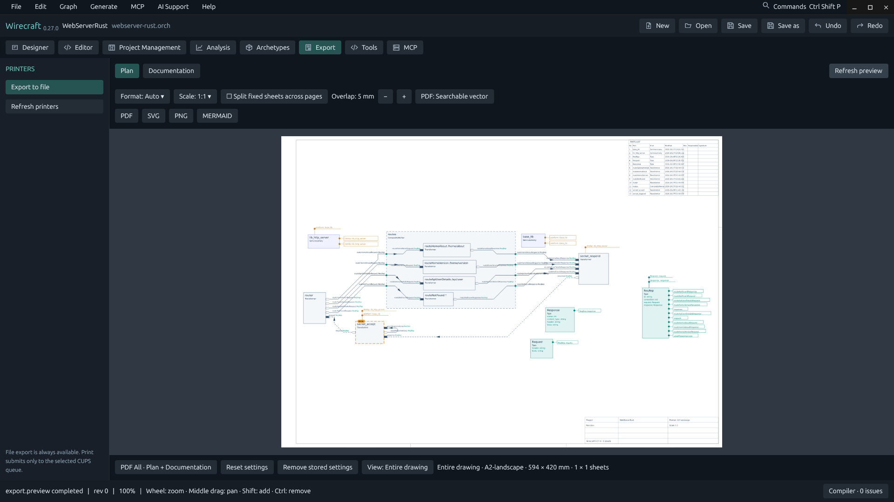
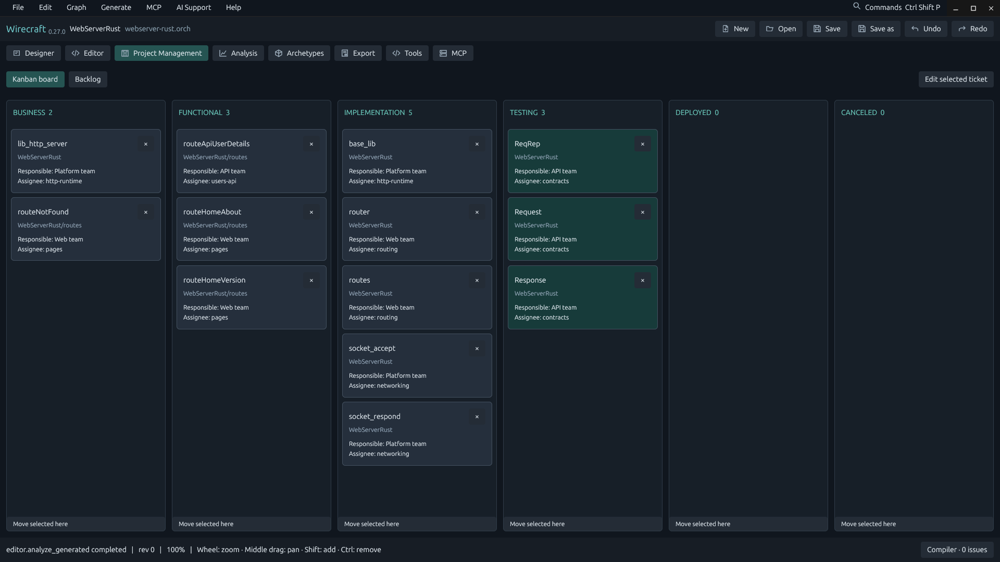
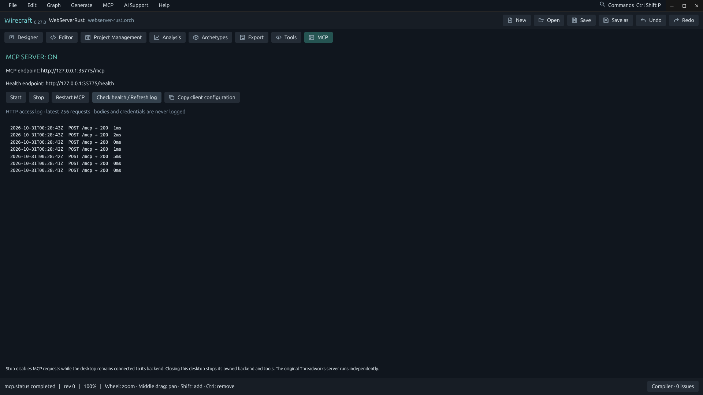

# Wirecraft — English Store listing

Design dataflow software visually and generate C17, Rust, Go, Kotlin, JavaScript or PHP programs from it. Edit processor bodies with language-server help, reuse components, export plans and connect AI agents through a local MCP server.

## Description

Design software as a dataflow graph, then generate the program from it.

Wirecraft is a free, open-source designer for event-driven and dataflow software. Place processors, data types and typed links on a canvas, group them into composites, and let 45-degree routing keep large topologies readable. Every link is a typed buffer, every processor a function, and service libraries are lent to the processors that use them.

From the same design Wirecraft generates complete programs in C17, Rust, Go, Kotlin, JavaScript (Node.js) and PHP. Write each processor's body in an editor that pins the generated function header above your code, so you always see the parameters the generator will pass. With clang, clangd or rust-analyzer installed, you get completion, hover documentation, semantic colors, go-to-definition, find references and compiler diagnostics mapped back to the entity and line you wrote.

Publish parts of a design as reusable components with typed ports, and reference them from other designs, pinned by content hash so updates are deliberate. Start new work from a library of archetypes, and inspect a design with network analysis of its data, error and dependency flows.

Around the design you also get project management (a Kanban board and backlog with status, responsibility and revision history), plan and documentation export to PDF, SVG, PNG and Mermaid for printing and sharing, and an optional local MCP server so compatible AI agents can read and edit the design through documented tools.

Wirecraft opens Threadworks .orch projects and preserves their data. No account is required and core design works offline. The application interface is in English. Wirecraft is under active development.

## Features

- Visual dataflow designer with processors, types, typed links and composites
- Readable 45-degree link routing for large topologies
- Generate C17, Rust, Go, Kotlin, JavaScript and PHP programs from one design
- Body editor with the generated function header pinned above your code
- Completion, hover, semantic colors and diagnostics with clangd or rust-analyzer
- Go-to-definition and find references across processor bodies
- Reusable components with typed ports, pinned by content hash
- Archetype library and network analysis of data, error and dependency flows
- Kanban board, backlog, responsibility and revision history
- Plan export to PDF, SVG, PNG and Mermaid, and a local MCP server for AI agents

## Search terms

dataflow, software design, code generation, C17, Rust, MCP server, architecture

## Screenshots

Design a web server as a dataflow graph of processors, types and typed links.

Group processors into composites; routed links show every typed buffer.

Publish a design as a reusable component with typed input and output ports.

Reference a component from another design; its ports join your links.

Edit a processor body under its pinned, generated C17 function header.

Complete the members of a lent library while you type, powered by clangd.

Read hover documentation in Rust bodies, with rust-analyzer installed.

Preview plans with a title block and export them to PDF, SVG, PNG or Mermaid.

Track entities on a Kanban board with status, responsibility and assignees.

Let AI agents work on the design through the local MCP server and its access log.
